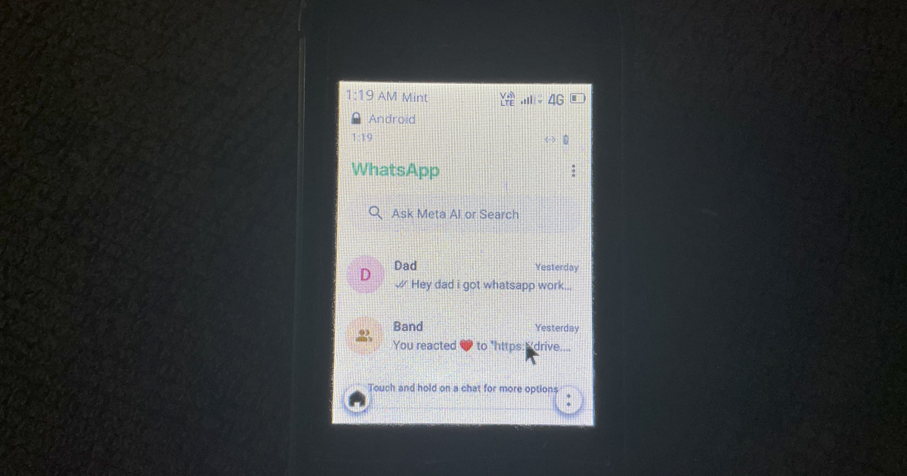

<!-- Title: WhatsApp on KaiOS: The Crazy Way -->
<!-- Date: 2026-09-27 -->
<!-- ThumbnailURL: 000-flip-phone.png -->

For those coming from the internet looking to get WhatsApp on your KaiOS Phone, I've got some good news and bad news.

The good news: It works! See the image below. You don't even need a physical smartphone to get it working with this approach, as I'll outline below.

The bad news: it is way more trouble than it is worth, at least for an American who scarcely uses WhatsApp.

[The code is here on GitHub](https://github.com/elliscode/android-on-kaios) if you want to take a look for yourself. Let's dive in!

## How did you do it?

Well, to be honest, I cheated. 

When I say I have WhatsApp running *on* my KaiOS Phone, what I really mean is I can *access* WhatsApp from my KaiOS phone. WhatsApp is running in an android emulator on a computer in my basement, not actually on my KaiOS device.

However, the end result is we get to *use* WhatsApp from a KaiOS device. You can send and recieve messages, whch is all we really need. We don't even need a physical smartphone, we can activate our WhatsApp account using a text message code sent to our flip phone, and entered into the android emulator.

### Setting up WhatsApp on an emulator

This is probably the most difficult part, as it requires a bit of fiddling to initially get WhatsApp to send a SMS code to your flip phone instead of your emulated device. Essentially we have to follow three steps:

- enable Google Play services and download WhatsApp
- disable Google Play services and open WhatsApp
- complete the signup process with a SMS code

The second step there is what enables us to open our account with an SMS code, as it allows for manually inputting the authentication code. Otherwise, our emulator would be waiting indefinitely for a SMS to be received on-device that would never come, as our emulator doesn't have a phone number.

Once your account is set up, you can re-enable Google Play services if you wish, to download other apps you might need to the emulator.

### From flip phone to Android

Now that you have an emulator running on your local, you need a way to connect to it remotely. Here's where the Express.js backend comes into play. The backend handles a few things, including display, touchscreen emulation, and the virtual keyboard.

#### The display: one screenshot per second

This might seem very stupid, but I find when working with KaiOS, stupid often gets the job done better. Essentially, what my web server does is:

- Every 1 second, screenshot the virtual phone screen
- If the hash of the image is different than the previous frame you sent, send it
- If the hash of the image is the same as the previous image you sent, don't send anything

That's it. This gives you a 1 frames per second display, which seems ridiculous on paper, but actually works pretty well for WhatsApp.

#### The touchscreen: click on that screenshot

The webpage that gets delivered to your KaiOS device is literally just a screenshot. When you click on that screenshot, the backend sends a touch event to the same spot you clicked on that screenshot. That's it really. There's a few special cases for defeating anti-bot prevention measures, specifically in the WhatsApp signup phone number enter screen, but really that's all it is for interacting. I mapped the <kbd>2</kbd> key and the <kbd>0</kbd> keys to scroll up and scroll down, as any KaiOS user should be familiar with, which sends a swipe event to the device

#### The text entry: click on a text field, get a <code>&lt;input type=text&gt;</code>

When you click on the screen on a text box, the frontend renders a <code>&lt;input type=text&gt;</code> for you to type your message into. This allows you to type with your familiar T-9 input scheme, instead of having to mouse click on keys on the UI screenshot. Pressing enter sets the text box value to whatever you typed.

## Is it worth it?

In all honesty, no not really. This was more of a proof of concept exercise on my part than a practical solution. The user experience is absolute trash, which I'm okay with because I don't really use whatsapp for much.